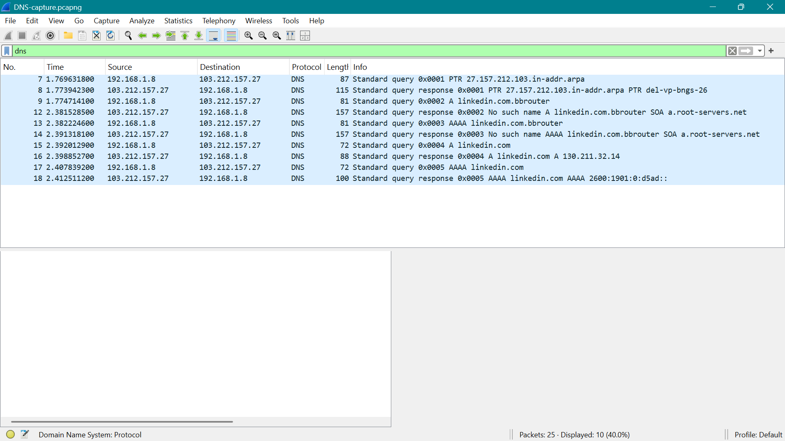

# DNS Traffic Analysis

## Capture

- **Tool:** Wireshark
- **Display filter:** `dns`
- **Packets captured:** 25
- **DNS packets displayed:** 10

## Evidence

- **Packet capture:** [`DNS-capture.pcapng`](DNS-capture.pcapng)

## Observations

The capture showed DNS query and response traffic generated while resolving `linkedin.com`.

### 1. DNS Query and Response

- **Packet 15:** A query for `linkedin.com`
- **Packet 16:** A response → `130.211.32.14`
- **Packet 17:** AAAA query for `linkedin.com`
- **Packet 18:** AAAA response → `2600:1901:0:d5ad::`

The A-record response provided the IPv4 address, while the AAAA-record response provided the IPv6 address.

The queries were sent from:

`192.168.1.8` → `103.212.157.27`

The responses were returned from:

`103.212.157.27` → `192.168.1.8`

### 2. UDP Communication

The DNS queries and responses in the capture used **UDP**, with the DNS server using port `53`.

## Key Findings

- The A-record lookup for `linkedin.com` successfully returned the IPv4 address `130.211.32.14`.
- The AAAA-record lookup for `linkedin.com` successfully returned the IPv6 address `2600:1901:0:d5ad::`.
- The DNS queries and responses were carried over **UDP**, with the DNS server using port `53`.

## Conclusion

The capture provided packet-level evidence of successful DNS resolution for `linkedin.com`. The domain was successfully resolved to both IPv4 and IPv6 addresses, demonstrating the DNS resolution process directly in the Wireshark capture.
