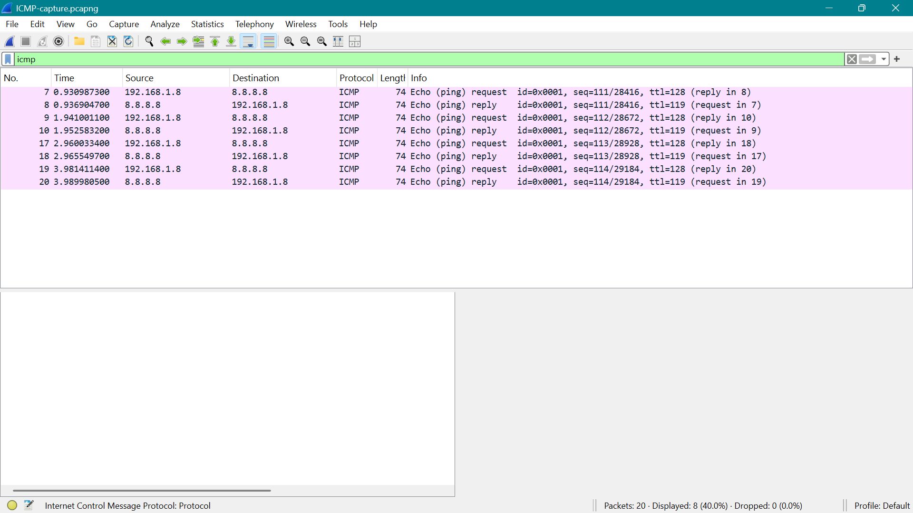

# ICMP Traffic Analysis

## Capture

- **Tool:** Wireshark
- **Display filter:** `icmp`
- **Packets captured:** 20
- **ICMP packets displayed:** 8

## Evidence

- **Packet capture:** [`ICMP-capture.pcapng`](ICMP-capture.pcapng)

## Observations

The capture showed ICMP Echo Request and Echo Reply traffic generated by a ping to `8.8.8.8`.

### 1. ICMP Request and Response

The capture contained four ICMP Echo Request/Reply pairs.

The requests were sent from:

`192.168.1.8` → `8.8.8.8`

The replies were returned from:

`8.8.8.8` → `192.168.1.8`

### 2. ICMP Packet Details

The captured packets were identified as **ICMP Echo Request** and **ICMP Echo Reply** messages.

The Echo Requests had a TTL of `128`, while the Echo Replies had a TTL of `119`.

## Key Findings

- ICMP Echo Requests were sent from the Windows host to `8.8.8.8`.
- ICMP Echo Replies were received from `8.8.8.8`.
- The capture contained four complete request/reply pairs.
- The traffic demonstrated successful ICMP communication between the host and the destination.

## Conclusion

The capture provided packet-level evidence of successful ICMP communication between the Windows host and `8.8.8.8`. The captured Echo Request and Echo Reply packets demonstrated that the host was able to send ICMP traffic and receive corresponding responses.
