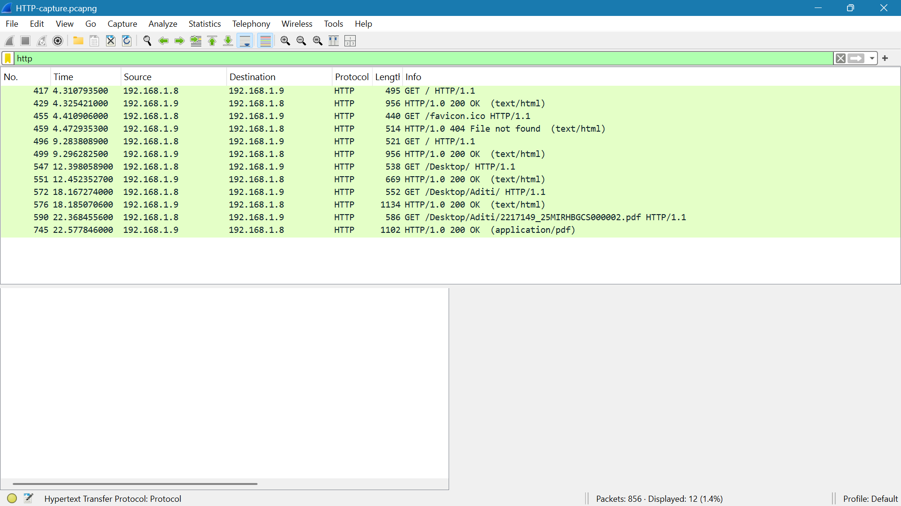

# HTTP Traffic Analysis

## Capture

- **Tool:** Wireshark
- **Display filter:** `http`
- **Client:** `192.168.1.8`
- **Server:** `192.168.1.9`
- **Packets captured:** 856
- **HTTP packets displayed:** 12

## Evidence

- **Packet capture:** [`HTTP-capture.pcapng`](HTTP-capture.pcapng)

## Observations

The capture showed HTTP communication between the client (`192.168.1.8`) and the server (`192.168.1.9`).

### 1. HTTP Request and Response

The client sent HTTP GET requests to port `8080` on the server.

Examples from the capture include:

- **Packet 417:** `GET / HTTP/1.1`
- **Packet 429:** `HTTP/1.0 200 OK`
- **Packet 496:** `GET / HTTP/1.1`
- **Packet 499:** `HTTP/1.0 200 OK`

The successful `200 OK` responses indicate that the requested resources were successfully returned by the server.

### 2. Additional HTTP Requests

The client also requested additional resources from the server:

- **Packet 455:** `GET /favicon.ico HTTP/1.1`
- **Packet 459:** `HTTP/1.0 404 File not found`
- **Packet 547:** `GET /Desktop/ HTTP/1.1`
- **Packet 551:** `HTTP/1.0 200 OK`
- **Packet 572:** `GET /Desktop/Aditi/ HTTP/1.1`
- **Packet 576:** `HTTP/1.0 200 OK`
- **Packet 590:** `GET /Desktop/Aditi/2217149_25MIRHBGCS000002.pdf HTTP/1.1`
- **Packet 745:** `HTTP/1.0 200 OK`

### 3. Client-Server Communication

The HTTP requests were sent from:

`192.168.1.8 → 192.168.1.9`

The server responses were returned in the reverse direction:

`192.168.1.9 → 192.168.1.8`

The HTTP server was listening on port `8080`.

## Key Findings

- The client (`192.168.1.8`) sent HTTP GET requests to the server (`192.168.1.9`).
- The server successfully returned `200 OK` responses for multiple requests.
- A request for `/favicon.ico` returned `404 File not found`.
- The capture also showed a PDF request followed by a successful `200 OK` response.
- The HTTP communication occurred between two separate devices over the local network.

## Conclusion

The capture provided packet-level evidence of HTTP communication between a client and server on the local network. The captured requests and responses demonstrated successful resource retrieval as well as an unsuccessful resource request.
