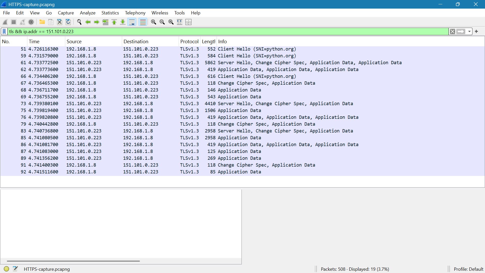

# HTTPS Traffic Analysis

## Capture

- **Tool:** Wireshark
- **Display filter:** `tls && ip.addr == 151.101.0.223`
- **Client:** `192.168.1.8`
- **Server:** `151.101.0.223`
- **Packets captured:** 508
- **Packets displayed:** 19

## Evidence

- **Packet capture:** [`HTTPS-capture.pcapng`](HTTPS-capture.pcapng)

## Observations

The capture showed TLS 1.3 communication between the client (`192.168.1.8`) and the server (`151.101.0.223`).

### 1. TLS Handshake

The capture contained TLS handshake packets between the client and server:

- **Packet 51:** `Client Hello (SNI=python.org)`
- **Packet 59:** `Client Hello (SNI=python.org)`
- **Packet 66:** `Client Hello (SNI=python.org)`
- **Packet 61:** `Server Hello, Change Cipher Spec, Application Data`
- **Packet 73:** `Server Hello, Change Cipher Spec, Application Data`
- **Packet 83:** `Server Hello, Change Cipher Spec, Application Data`

The Client Hello packets identify `python.org` through the Server Name Indication (SNI).

### 2. Encrypted Application Data

The capture also contained multiple `Application Data` packets exchanged between the client and server.

The captured application data is represented as TLS `Application Data` rather than readable HTTP requests or responses.

## Key Findings

- The capture showed TLS 1.3 communication between the client and server.
- The TLS handshake included `Client Hello` and `Server Hello` messages.
- The SNI in the Client Hello identified `python.org`.
- Multiple encrypted `Application Data` packets were exchanged after the handshake.
- The captured application data was not displayed as readable HTTP content.

## Conclusion

The capture provided packet-level evidence of a TLS 1.3 connection between the client and server. The TLS handshake and subsequent `Application Data` packets demonstrated encrypted HTTPS communication, with `python.org` identified through SNI.
