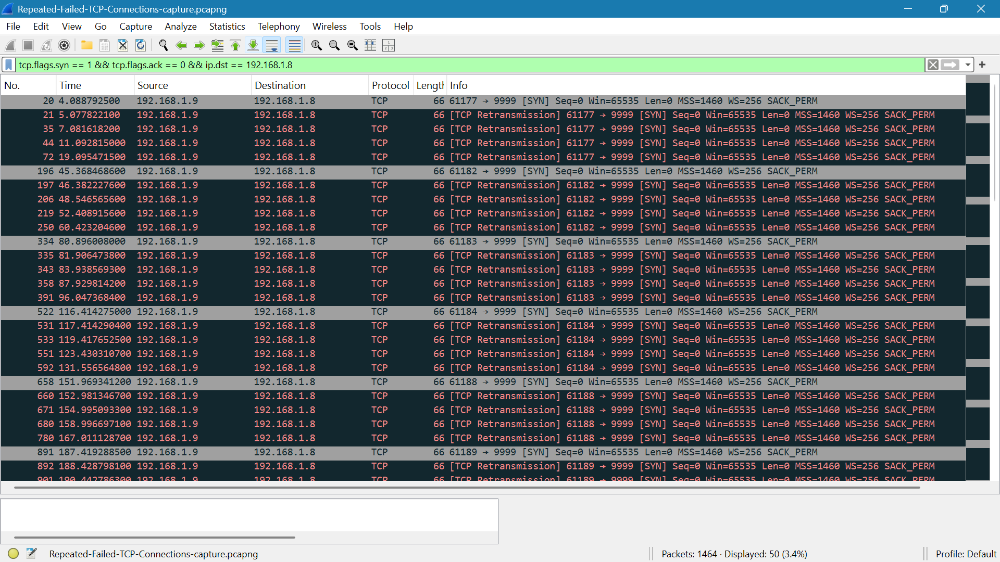

# Repeated Failed TCP Connections

## Capture

- **Tool:** Wireshark
- **Display filter:** `tcp.flags.syn == 1 && tcp.flags.ack == 0 && ip.dst == 192.168.1.8`
- **Packets captured:** 1464
- **Packets displayed:** 50

## Evidence

- **Packet capture:** [`Repeated-Failed-TCP-Connections-capture.pcapng`](Repeated-Failed-TCP-Connections-capture.pcapng)

## Observations

The capture showed repeated TCP connection attempts from `192.168.1.9` to `192.168.1.8` on port `9999`.

### 1. Repeated SYN Attempts

The filtered traffic contained multiple TCP SYN packets directed to port `9999`.

- **Packet 20:** `61177` → `9999` [SYN]
- **Packet 196:** `61182` → `9999` [SYN]
- **Packet 334:** `61183` → `9999` [SYN]
- **Packet 522:** `61184` → `9999` [SYN]
- **Packet 658:** `61188` → `9999` [SYN]
- **Packet 891:** `61189` → `9999` [SYN]
- **Packet 1025:** `61190` → `9999` [SYN]
- **Packet 1107:** `61195` → `9999` [SYN]
- **Packet 1200:** `61196` → `9999` [SYN]
- **Packet 1338:** `61197` → `9999` [SYN]

The use of different source ports shows multiple separate TCP connection attempts.

### 2. TCP SYN Retransmissions

Several of the SYN packets were retransmitted.

For example, the SYN from source port `61177` was followed by multiple `[TCP Retransmission]` packets before another connection attempt using a different source port appeared.

The repeated retransmissions indicate that the connection attempts did not receive the expected TCP response.

## Key Findings

- Multiple TCP connection attempts were directed from `192.168.1.9` to `192.168.1.8:9999`.
- The attempts used different source ports.
- The capture showed repeated SYN retransmissions.
- No successful TCP connection establishment is visible in the filtered traffic.
- The repeated connection attempts produced a recognizable pattern in Wireshark.

## Conclusion

The capture provided packet-level evidence of repeated unsuccessful TCP connection attempts toward port `9999`. The repeated SYN packets and retransmissions demonstrate how repeated connection probing can appear in network traffic and be identified through packet-level analysis.
