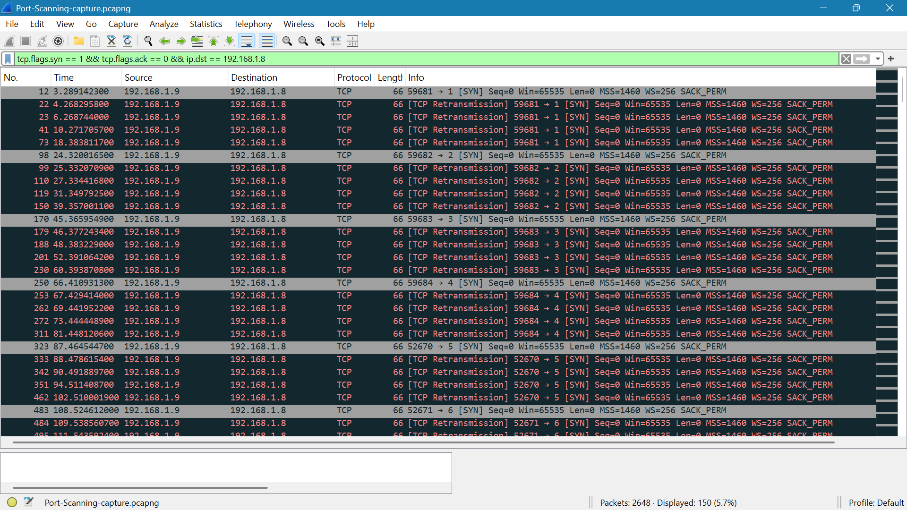

# Port Scanning

## Capture

- **Tool:** Wireshark
- **Display filter:** `tcp.flags.syn == 1 && tcp.flags.ack == 0 && ip.dst == 192.168.1.8`
- **Packets captured:** 2648
- **Packets displayed:** 150

## Evidence

- **Packet capture:** [`Port-Scanning-capture.pcapng`](Port-Scanning-capture.pcapng)

## Observations

The capture showed TCP connection attempts from `192.168.1.9` to `192.168.1.8` across multiple destination ports.

### 1. SYN Probes Across Multiple Ports

The filtered traffic contained TCP SYN packets targeting different destination ports.

Examples include:

- **Packet 12:** `59681` → `1` [SYN]
- **Packet 98:** `59682` → `2` [SYN]
- **Packet 170:** `59683` → `3` [SYN]
- **Packet 250:** `59684` → `4` [SYN]
- **Packet 323:** `52670` → `5` [SYN]
- **Packet 483:** `52671` → `6` [SYN]

The destination port changes across successive connection attempts, showing that multiple ports on the target were being probed.

### 2. SYN Retransmissions

The capture also showed `[TCP Retransmission]` packets following several SYN attempts.

For example, the SYN sent to port `1` was followed by multiple retransmissions before the scan proceeded to another destination port.

This indicates that the probes did not receive the expected TCP response from the target for these attempts.

## Key Findings

- TCP SYN probes were sent from `192.168.1.9` to `192.168.1.8`.
- Multiple destination ports were targeted sequentially.
- The capture showed SYN retransmissions for several probes.
- The capture provided a recognizable pattern of multiple-port TCP probing.

## Conclusion

The capture provided packet-level evidence of TCP port-scanning activity. SYN packets were sent from `192.168.1.9` toward multiple destination ports on `192.168.1.8`, producing a recognizable multi-port probing pattern in Wireshark.
