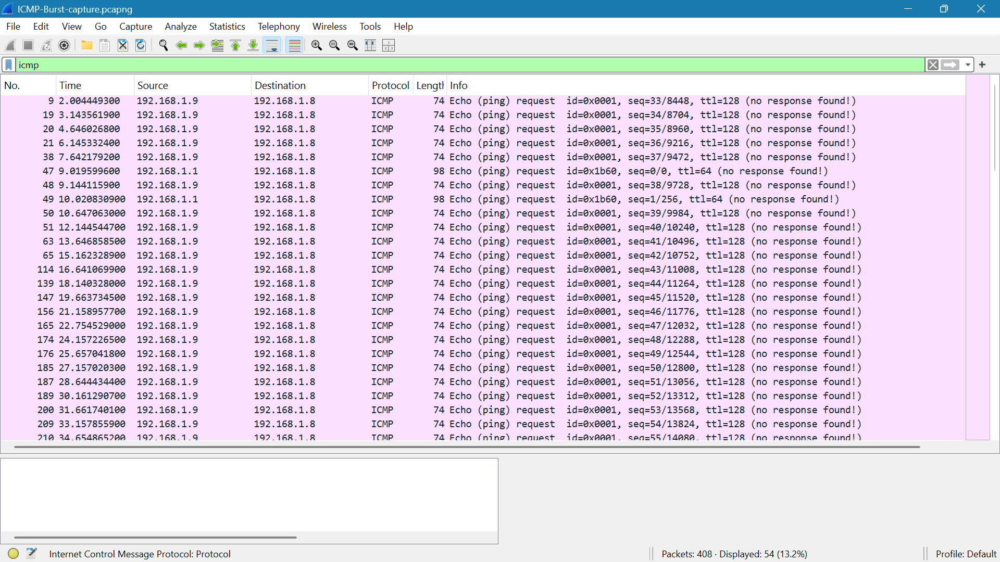

# ICMP Burst Traffic Analysis

## Capture

- **Tool:** Wireshark
- **Display filter:** `icmp`
- **Packets captured:** 408
- **ICMP packets displayed:** 54

## Evidence

- **Packet capture:** [`ICMP-Burst-capture.pcapng`](ICMP-Burst-capture.pcapng)

## Observations

The capture showed repeated ICMP Echo Request traffic from `192.168.1.9` to `192.168.1.8`.

### 1. Repeated ICMP Requests

Multiple Echo Request packets were sent from:

`192.168.1.9` → `192.168.1.8`

The ICMP Echo Requests had increasing sequence numbers, indicating that multiple successive requests were being sent to the target.

### 2. ICMP Traffic Pattern

The repeated requests created a recognizable pattern of ICMP traffic directed toward the same target.

The displayed Echo Requests show the Wireshark annotation: `(no response found!)`

No corresponding Echo Reply packets from `192.168.1.8` are visible for these displayed requests.

### 3. Other ICMP Traffic

The capture also contained a small amount of ICMP traffic from `192.168.1.1` to `192.168.1.8`. This was separate from the repeated traffic generated by `192.168.1.9`.

## Key Findings

- Repeated ICMP Echo Requests were sent from `192.168.1.9` to `192.168.1.8`.
- The requests used sequential ICMP sequence numbers.
- No corresponding Echo Replies are visible for the displayed requests from `192.168.1.9`.
- The repeated requests produced a recognizable ICMP traffic pattern in Wireshark.

## Conclusion

The capture provided packet-level evidence of repeated ICMP Echo Request traffic directed from `192.168.1.9` toward `192.168.1.8`. The repeated requests and increasing sequence numbers demonstrate how a burst of ICMP traffic can appear in a network capture and be identified through Wireshark.
